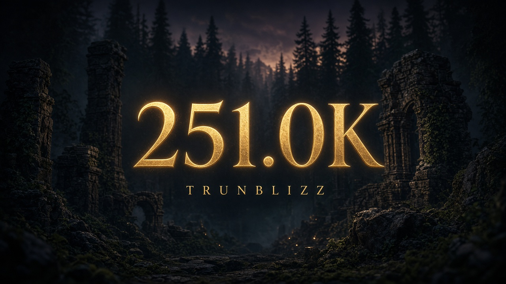

<p align="center">
  
</p>

<p align="center">
  <a href="https://github.com/RosemyneH/TrunBlizzDmg335Patcher/releases/tag/1.0"></a>
  <a href="https://github.com/RosemyneH/TrunBlizzDmg335Patcher/actions/workflows/build.yml"></a>
  <a href="LICENSE"></a>
</p>

<p align="center">
  Short combat numbers for a 3.3.5a client.<br>
  <code>115232</code> is drawn as <code>115.2K</code>. <code>2400000</code> is drawn as <code>2.4M</code>.
</p>

Values under 1000 stay as they are. The first decimal is cut off, not rounded.

## Download

Grab the [1.0 release](https://github.com/RosemyneH/TrunBlizzDmg335Patcher/releases/tag/1.0).

| File | Use |
| --- | --- |
| `TrunBlizzDmg335Patcher.exe` | Patches a 32-bit client or 64 bit client, based on what u point at |
| `TrunBlizzDmg335Patcher.dll` | Loaded by that client |
| `TrunBlizzDmg335Patcher-linux` | Patches a 32-bit client or 64 bit client, based on what u point at |
| `libTrunBlizzDmg335Patcher.so` | Loaded by that client |

## 32-bit client

`Wow.exe` and `WowExt.exe` from build 12340 both work. Copy the exe and the dll into the game folder, then:

```text
TrunBlizzDmg335Patcher.exe WowExt.exe
```

The patcher writes `WowExt.exe.bak` once and adds an import named `TrunBlizzLoad`. Run it again and an already patched client is left alone. Quit the game completely before starting the patched exe. A client that hashes its own exe will see a different file.

## 64-bit client

Copy `TrunBlizzDmg335Patcher-linux` and `libTrunBlizzDmg335Patcher.so` next to the unstripped `WowClient64`, then:

```text
chmod +x TrunBlizzDmg335Patcher-linux
./TrunBlizzDmg335Patcher-linux ./WowClient64
```

That writes `TrunBlizzDmg335.sh`. Launch the script. The library finds `PlayerNameCreateText` from the symbol table, so a rebuild still works while those symbols remain.

## What changes

World numbers over a unit, the scrolling combat text, and the portrait feedback text. Miss, absorb, and the chat combat log stay written out in full.

## Build

```text
make
```

That runs the tests and produces the Linux patcher, `libTrunBlizzDmg335Patcher.so`, and the 32-bit dll and exe. The 32-bit compiler is `i686-w64-mingw32-gcc`.

## License

[MIT](LICENSE)
